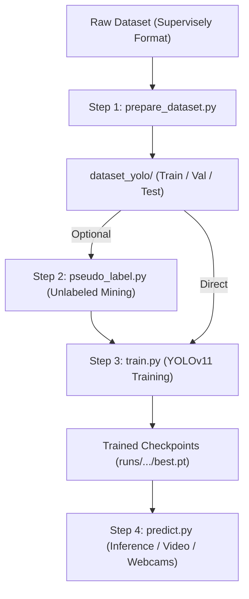

# Pipeline Execution Guide: Road Pothole Detection

This document outlines the standard end-to-end execution order for the dataset preparation, optional semi-supervised mining, model training, and inference pipelines.

---

## Prerequisites

Ensure your virtual environment is activated and dependencies are installed:

```powershell
Set-Location -Path "C:\Users\anton\Documents\siridl-pap"
.\.venv\Scripts\Activate.ps1
```

---

## Execution Flow



---

### Step 1: Prepare Dataset (`prepare_dataset.py`)

Parses Supervisely annotations, drops byte and re-compressed duplicates, purges test leakage, groups continuous camera bursts into disjoint drive sequences, and generates the YOLO directory tree.

```powershell
python prepare_dataset.py
```

#### Useful Flags:
* `--dry-run`: Scans, validates, and reports statistics without writing files to disk.
* `--negatives-ratio 0.10`: Injects ~10% clean negative background road scenes into train/val.
* `--no-split-by-sequence`: Reverts to random image-level shuffle (default is sequence-aware burst grouping).
* `--val-ratio 0.10`: Fraction of training data allocated to validation (default: 0.10).

---

### Step 2 (Optional): Mine Pseudo-Labels (`pseudo_label.py`)

Scans the ~8,500 unannotated road images using an existing trained checkpoint to mine high-confidence potholes, avoiding manual labeling effort while expanding dataset diversity.

```powershell
python pseudo_label.py --conf 0.75 --batch-size 32
```

#### Useful Flags:
* `--model <path>`: Checkpoint to use for detections (default: `runs/detect/runs/pothole/baseline/weights/best.pt`).
* `--conf 0.75`: Minimum confidence threshold to accept mined boxes (conservative threshold prevents false positives).
* `--device 0`: GPU device ID (`0`, `cpu`, or `mps`).

---

### Step 3: Train YOLO Detector (`train.py`)

Trains the YOLO detection network, logs live training progress and ETAs, evaluates the best checkpoint on the held-out test split, and exports a summary report.

```powershell
python train.py --model yolo11s.pt --epochs 100 --imgsz 1280 --batch -1
```

#### Useful Flags:
* `--model yolo11s.pt`: Starting architecture (`yolo11n.pt`, `yolo11s.pt`, `yolo11m.pt`).
* `--imgsz 1280`: Image resolution for training and validation (1280px recommended for small road potholes).
* `--batch -1`: Automatically selects maximum batch size that fits in ~60% of GPU VRAM.
* `--resume <path>`: Resumes an interrupted run from a `last.pt` checkpoint.
* `--eval-split test`: Evaluates the best model on the clean held-out test set upon training completion.
* `--export onnx`: Automatically exports best model weights to ONNX upon completion.

---

### Step 4: Run Inference & Deployment (`predict.py`)

Runs the trained detector on individual photos, directories of dashcam footage, video recordings, or real-time webcams.

#### 1. Single Reference Image:
```powershell
python predict.py reference.jpg --conf 0.25
```

#### 2. Directory of Dashcam Images (with JSON report and cropped detections):
```powershell
python predict.py "photos/*.jpg" --conf 0.25 --save-crops --json --csv
```

#### 3. Municipal Drive Video:
```powershell
python predict.py drive_recording.mp4 --imgsz 1280 --conf 0.25
```

#### 4. Live Webcam / In-Vehicle Stream:
```powershell
python predict.py 0 --imgsz 1280 --conf 0.25
```

---

## File and Artifact Locations

| Artifact | Path | Description |
| :--- | :--- | :--- |
| **Source Data** | `dataset/` | Original Supervisely images and annotations (`ds1`, `ds2`) |
| **YOLO Dataset** | `dataset_yolo/` | Formatted YOLO images, labels, and `data.yaml` |
| **Dataset Report** | `dataset_yolo/dataset_report.json` | Audit counts, box statistics, and deduplication records |
| **Best Weights** | `runs/detect/runs/pothole/baseline/weights/best.pt` | Highest-mAP checkpoint from training |
| **Inference Results** | `predictions/results/` | Output images, crop extracts, JSON logs, and bounding box plots |
