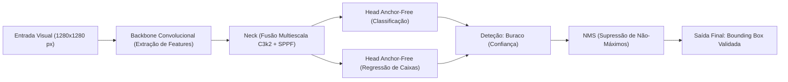
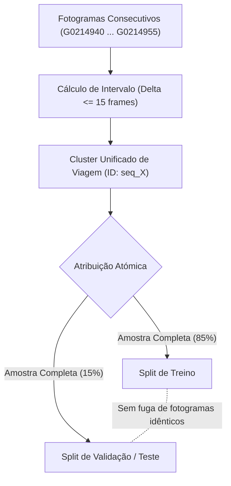
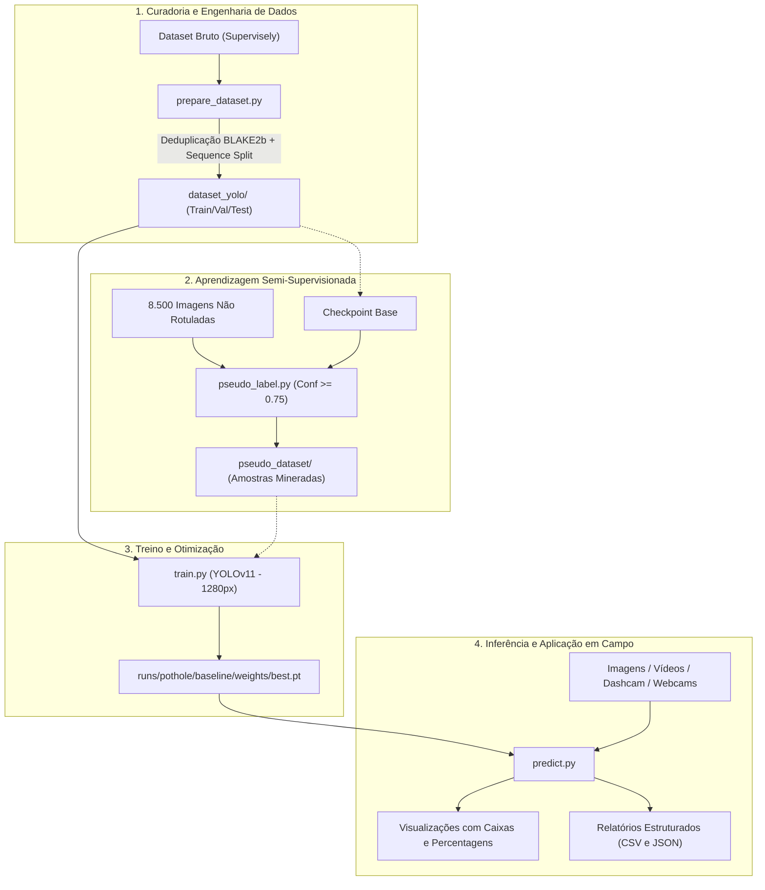
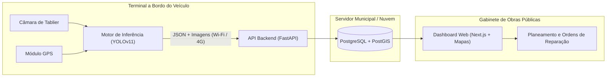

# Escola Secundária de Loulé
### Curso Profissional Técnico de Gestão e Programação de Sistemas Informáticos (CPTPI / TGPSI)
### Ano Letivo: 2025/2026

<br>

---

<br>

# SIRI-DL: Auditoria Rodoviária Inteligente
## Deteção de Anomalias no Pavimento com Deep Learning e Análise Geoespacial

<br>

### Prova de Aptidão Profissional (PAP)
### Relatório de Projeto

<br>

**Autor:** António Bastos  
**Diretor de Curso:** Filipe Jesus  
**Orientador:** Jorge Louro  

<br>

**Loulé, 2026**

---

<br>

## Agradecimentos

Gostaria de expressar o meu sincero reconhecimento e profunda gratidão a todos os professores que, ao longo do meu percurso no Curso Profissional Técnico de Gestão e Programação de Sistemas Informáticos da Escola Secundária de Loulé, disponibilizaram o seu tempo, conhecimento e orientação contínua para tornar viável a conceção e o desenvolvimento desta Prova de Aptidão Profissional (PAP).

Um agradecimento especialmente dirigido ao meu Orientador de Projeto, Professor Jorge Louro, e ao Diretor de Curso, Professor Filipe Jesus, pelo acompanhamento metodológico, rigor técnico e confiança transmitida desde a definição da ideia inicial até à concretização dos pipelines de engenharia de software e inteligência artificial.

Agradeço igualmente aos professores Carlos Gomes e Paulo Cavaco, pela constante disponibilidade em debater soluções técnicas e partilhar perspetivas fundamentais de arquitetura de sistemas e infraestruturas tecnológicas.

Estendo o meu apreço à Escola Secundária de Loulé, por facultar os meios materiais e laboratoriais que permitiram a realização dos testes e experiências computacionais exigidas por este projeto.

Uma palavra de profundo apreço às equipas e empresas de acolhimento na Lituânia e na Eslováquia, onde tive o privilégio de realizar os meus estágios de Formação em Contexto de Trabalho (FCT) no âmbito do programa Erasmus+. O contacto com padrões de trabalho internacionais, a autonomia técnica adquirida e a vivência em diferentes contextos de engenharia de software foram pilares estruturantes para a minha maturidade pessoal e profissional, refletindo-se diretamente no rigor aplicado neste projeto.

Por fim, agradeço aos meus colegas de turma e à minha família pelo incentivo permanente, pela paciência demonstrada durante as longas jornadas de trabalho e pela motivação indispensável em todas as fases desta jornada académica.

---

## Resumo

O presente relatório descreve a conceção, arquitetura e implementação prática do **SIRI-DL** (*Sistema Inteligente de Reconhecimento de Infraestruturas – Deep Learning*), uma solução tecnológica orientada para a auditoria contínua e automatizada do estado de conservação do pavimento rodoviário. As câmaras municipais e concessionárias de infraestruturas enfrentam custos operacionais vultuosos e limitações severas na fiscalização de anomalias viárias (fissuras, tampas de esgoto desniveladas e buracos no asfalto), dependendo amiúde de vistorias manuais lentas ou de reclamações tardias de munícipes, o que acarreta danos materiais nas viaturas e riscos graves para a segurança rodoviária.

O sistema desenvolvido propõe uma abordagem *Data-Centric* baseada em Visão Computacional e *Deep Learning*. Instalado num dispositivo móvel ou câmara de bordo (*dashcam*) a operar em veículos de frotas municipais já em circulação diária (como viaturas de fiscalização ou de recolha de resíduos), o sistema processa fotogramas de vídeo em tempo real, detetando automaticamente a presença de buracos (*potholes*), calculando a sua severidade com base na percentagem de área afetada e delimitando-os espacialmente com elevada precisão.

O trabalho desenvolvido até ao momento incidiu sobre os componentes críticos do motor de inteligência artificial e de engenharia de dados:
1. Um pipeline de auditoria criptográfica e curadoria de dados com remoção de mais de 2.800 duplicados exatos e resolução de anotações conflituantes;
2. Um algoritmo inovador de agrupamento de capturas contínuas (*burst clustering*) para erradicar o problema de fuga de dados (*data leakage*) entre os conjuntos de treino e validação;
3. Um pipeline de mineração semi-supervisionada (*pseudo-labeling*) em GPU para enriquecimento do conjunto de treino a partir de milhares de amostras rodoviárias não rotuladas;
4. O treino e ajuste fino de arquiteturas avançadas de deteção de objetos (YOLOv11/YOLOv8) em alta resolução (1280 px);
5. Um motor de inferência robusto preparado para análise de imagens, pastas, fluxos de vídeo e câmaras ao vivo, com exportação de relatórios em formatos estruturados (CSV e JSON).

O projeto prevê a sua integração futura com um módulo de telemetria GPS e um *backend* geoespacial suportado em PostgreSQL/PostGIS e FastAPI, alimentando uma plataforma *web* interativa com mapas vetoriais para apoio à decisão e planeamento célere de intervenções de obras públicas.

**Palavras-Chave:** Prova de Aptidão Profissional; Deteção de Buracos Rodoviários; Visão Computacional; Deep Learning; YOLOv11; Curadoria de Dados; Fuga de Dados; Auditoria Rodoviária; Engenharia de Software.

---

## Abstract

This document presents the design, technical architecture, and practical implementation of **SIRI-DL** (*Intelligent Road Infrastructure Recognition System – Deep Learning*), an automated computer vision solution dedicated to continuous road surface monitoring and audit. Municipal councils and infrastructure authorities spend substantial financial and logistical resources on manual road condition assessments. Late detection of pavement anomalies such as potholes and surface distress leads to vehicle damage, traffic disruptions, and significant road safety hazards.

SIRI-DL addresses this challenge through a cost-effective, data-centric artificial intelligence pipeline. Deployed on mobile terminals or dashcams mounted on regular municipal utility fleets (such as waste management or municipal inspection vehicles), the system analyzes video streams in real time. It identifies road potholes, computes damage severity based on bounding box area coverage, and extracts high-precision spatial coordinates.

The system engineering accomplished to date focuses on the core deep learning and dataset processing foundations:
1. A rigorous cryptographic deduplication engine utilizing BLAKE2b hashing, eliminating over 2,800 duplicate frames and reconciling conflicting multi-dataset annotations;
2. A sequence-aware drive grouping algorithm preventing sequence leakage across consecutive video burst frames between training and validation splits;
3. A high-throughput semi-supervised pseudo-labeling pipeline leveraging GPU batch inference to mine unannotated road imagery;
4. The training, hyperparameter optimization, and evaluation of state-of-the-art YOLOv11 architectures at 1280 px resolution;
5. A versatile inference engine supporting static imagery, video recordings, and real-time camera streams, complete with automated metric reporting in JSON and CSV formats.

Future extensions will interface this detector with a GPS telemetry module and a geospatial backend driven by FastAPI, PostgreSQL, and PostGIS, culminating in an interactive web GIS dashboard for municipal public works management.

**Keywords:** Professional Aptitude Exam; Road Pothole Detection; Computer Vision; Deep Learning; YOLOv11; Data-Centric AI; Sequence Leakage; Road Infrastructure Audit; Python.

---

## Lista de Acrónimos e Siglas

| Acrónimo | Significado por Extenso |
| :--- | :--- |
| **API** | *Application Programming Interface* |
| **BLAKE2b** | *Cryptographic Hash Function (Digest Algorithm)* |
| **CLI** | *Command Line Interface* (Interface de Linha de Comandos) |
| **CPTPI** | Curso Profissional Técnico Programador de Informática |
| **CUDA** | *Compute Unified Device Architecture* (NVIDIA) |
| **DFL** | *Distribution Focal Loss* |
| **DL** | *Deep Learning* (Aprendizagem Profunda) |
| **EXIF** | *Exchangeable Image File Format* |
| **FCT** | Formação em Contexto de Trabalho |
| **FP16 / FP32** | *Floating Point 16-bit (Half) / 32-bit (Single Precision)* |
| **FPS** | *Frames Per Second* (Fotogramas por Segundo) |
| **GIS / SIG** | *Geographic Information System* / Sistema de Informação Geográfica |
| **GPS** | *Global Positioning System* |
| **GPU** | *Graphics Processing Unit* (Unidade de Processamento Gráfico) |
| **IoU** | *Intersection over Union* |
| **JSON** | *JavaScript Object Notation* |
| **mAP** | *Mean Average Precision* |
| **mAP50** | *Mean Average Precision at IoU Threshold 0.50* |
| **mAP50-95** | *Mean Average Precision averaged over IoU Thresholds 0.50 to 0.95* |
| **NMS** | *Non-Maximum Suppression* |
| **ONNX** | *Open Neural Network Exchange* |
| **PAP** | Prova de Aptidão Profissional |
| **PostGIS** | *Spatial Database Extender for PostgreSQL* |
| **RGB** | *Red, Green, Blue* (Espaço de Cor) |
| **SDK** | *Software Development Kit* |
| **TGPSI** | Técnico de Gestão e Programação de Sistemas Informáticos |
| **TTA** | *Test-Time Augmentation* |
| **VRAM** | *Video Random Access Memory* |
| **YOLO** | *You Only Look Once* (Família de Modelos de Deteção de Objetos) |

---

## Índice Geral

- [Escola Secundária de Loulé](#escola-secundária-de-loulé)
- [Agradecimentos](#agradecimentos)
- [Resumo](#resumo)
- [Abstract](#abstract)
- [Lista de Acrónimos e Siglas](#lista-de-acrónimos-e-siglas)
- [Índice de Figuras e Tabelas](#índice-de-figuras-e-tabelas)
- [Introdução](#introdução)
  - [1. Contextualização e Enquadramento](#1-contextualização-e-enquadramento)
  - [2. O Problema Real](#2-o-problema-real)
  - [3. A Solução Proposta](#3-a-solução-proposta)
  - [4. Objetivos Gerais e Específicos](#4-objetivos-gerais-e-específicos)
  - [5. Organização do Relatório](#5-organização-do-relatório)
- [Capítulo 1 – Enquadramento Institucional e Percurso Formativo](#capítulo-1--enquadramento-institucional-e-percurso-formativo)
  - [1.1 Os Cursos Profissionais e a Dupla Certificação](#11-os-cursos-profissionais-e-a-dupla-certificação)
  - [1.2 O Curso de TGPSI na Escola Secundária de Loulé](#12-o-curso-de-tgpsi-na-escola-secundária-de-loulé)
  - [1.3 A Formação em Contexto de Trabalho (FCT) e a Experiência Erasmus+](#13-a-formação-em-contexto-de-trabalho-fct-e-a-experiência-erasmus)
  - [1.4 A Prova de Aptidão Profissional (PAP)](#14-a-prova-de-aptidão-profissional-pap)
- [Capítulo 2 – Fundamentação Teórica e Tecnologias](#capítulo-2--fundamentação-teórica-e-tecnologias)
  - [2.1 Visão Computacional e Deteção de Objetos](#21-visão-computacional-e-deteção-de-objetos)
  - [2.2 A Evolução das Redes Neurais YOLO (YOLOv8 e YOLOv11)](#22-a-evolução-das-redes-neurais-yolo-yolov8-e-yolov11)
  - [2.3 Linguagens e Bibliotecas de Suporte](#23-linguagens-e-bibliotecas-de-suporte)
  - [2.4 Ambiente de Desenvolvimento e Ferramentas](#24-ambiente-de-desenvolvimento-e-ferramentas)
- [Capítulo 3 – Engenharia e Curadoria de Dados (Data-Centric AI)](#capítulo-3--engenharia-e-curadoria-de-dados-data-centric-ai)
  - [3.1 Análise do Dataset de Origem e Formato Supervisely](#31-análise-do-dataset-de-origem-e-formato-supervisely)
  - [3.2 Deduplicação Criptográfica com BLAKE2b e Resolução de Conflitos](#32-deduplicação-criptográfica-com-blake2b-e-resolução-de-conflitos)
  - [3.3 Prevenção de Fuga de Dados (Data Leakage) em Rajadas de Câmara](#33-prevenção-de-fuga-de-dados-data-leakage-em-rajadas-de-câmara)
  - [3.4 Auditoria do Pool de Amostras Negativas e Risco de Penalização](#34-auditoria-do-pool-de-amostras-negativas-e-risco-de-penalização)
  - [3.5 Geração Otimizada do Dataset YOLO (Zero-Copy Hardlinks)](#35-geração-otimizada-do-dataset-yolo-zero-copy-hardlinks)
- [Capítulo 4 – Arquitetura e Implementação do Sistema](#capítulo-4--arquitetura-e-implementação-do-sistema)
  - [4.1 Arquitetura Geral do Pipeline](#41-arquitetura-geral-do-pipeline)
  - [4.2 Motor de Preparação e Normalização (`prepare_dataset.py`)](#42-motor-de-preparação-e-normalização-prepare_datasetpy)
  - [4.3 Mineração Semi-Supervisionada de Pseudo-Labels (`pseudo_label.py`)](#43-mineração-semi-supervisionada-de-pseudo-labels-pseudo_labelpy)
  - [4.4 Pipeline de Treino e Otimização Rodoviária (`train.py`)](#44-pipeline-de-treino-e-otimização-rodoviária-trainpy)
  - [4.5 Motor de Inferência e Exportação Analítica (`predict.py`)](#45-motor-de-inferência-e-exportação-analítica-predictpy)
  - [4.6 Interface de Terminal e Monitorização (`terminal_ui.py`)](#46-interface-de-terminal-e-monitorização-terminal_uipy)
- [Capítulo 5 – Demonstração, Testes e Resultados Obtidos](#capítulo-5--demonstração-testes-e-resultados-obtidos)
  - [5.1 Resultados da Auditoria e Curadoria do Dataset](#51-resultados-da-auditoria-e-curadoria-do-dataset)
  - [5.2 Resultados e Dinâmica do Treino do Modelo](#52-resultados-e-dinâmica-do-treino-do-modelo)
  - [5.3 Avaliação de Inferência em Cenários Reais](#53-avaliação-de-inferência-em-cenários-reais)
  - [5.4 Discussão de Desafios: Sombras, Humidade e Falsos Positivos](#54-discussão-de-desafios-sombras-humidade-e-falsos-positivos)
- [Capítulo 6 – Estado Atual e Próximas Fases do Ecossistema](#capítulo-6--estado-atual-e-próximas-fases-do-ecossistema)
  - [6.1 Síntese do que está Concluído e Operacional](#61-síntese-do-que-está-concluído-e-operacional)
  - [6.2 Módulo de Telemetria e Aquisição em Campo (GPS)](#62-módulo-de-telemetria-e-aquisição-em-campo-gps)
  - [6.3 Backend Geoespacial (FastAPI + PostgreSQL / PostGIS)](#63-backend-geoespacial-fastapi--postgresql--postgis)
  - [6.4 Plataforma Web de Apoio à Decisão (Frontend SIG)](#64-plataforma-web-de-apoio-à-decisão-frontend-sig)
- [Conclusão](#conclusão)
- [Propostas Futuras](#propostas-futuras)
- [Referências Bibliográficas](#referências-bibliográficas)

---

## Índice de Figuras e Tabelas

* **Tabela 1:** Resumo do resultado da desduplicação e deteção de fuga de dados.
* **Tabela 2:** Distribuição de amostras e caixas delimitadoras no dataset tratado.
* **Tabela 3:** Matriz de hiperparâmetros de treino configurados no pipeline `train.py`.
* **Tabela 4:** Especificações e funcionalidades dos módulos de software desenvolvidos.
* **Figura 1:** Diagrama de fluxo ponta a ponta do pipeline SIRI-DL.
* **Figura 2:** Diagrama de agrupamento de rajadas de fotogramas (*sequence-aware burst clustering*).
* **Figura 3:** Diagrama de blocos da arquitetura futura do ecossistema geoespacial.

---

<br>

# Introdução

## 1. Contextualização e Enquadramento

A manutenção e fiscalização da rede rodoviária representam um dos desafios mais exigentes e onerosos para a administração pública local, em particular para os serviços municipais de obras públicas e infraestruturas urbanas. As vias de comunicação sofrem desgaste permanente devido ao tráfego rodoviário intenso, às amplitudes térmicas e à pluviosidade, provocando degradações sucessivas no asfalto que se traduzem em fissuras, perda de aderência e, de forma mais crítica, na formação de buracos (*potholes*) e desnivelamento de tampas de saneamento.

No contexto das cidades e estradas municipais portuguesas, a preservação do estado de conservação das vias rodoviárias constitui um imperativo de segurança pública. Uma depressão no pavimento não detetada atempadamente aumenta substancialmente o risco de acidentes rodoviários, provoca danos avultados nos sistemas de suspensão e pneus dos veículos particulares e de transporte coletivo, e conduz à degradação acelerada das camadas estruturais da estrada, transformando intervenções de reparação simples em obras de repavimentação de custo exorbitante.

O projeto **SIRI-DL** (*Sistema Inteligente de Reconhecimento de Infraestruturas – Deep Learning*) surge no seio da Prova de Aptidão Profissional (PAP) como uma resposta técnica e pragmática a este problema, combinando os avanços recentes em Visão Computacional, Inteligência Artificial e Engenharia de Software para capacitar as entidades gestoras com uma ferramenta contínua, automatizada e de baixo custo para auditoria rodoviária.

## 2. O Problema Real

Atualmente, o processo de identificação e diagnóstico de patologias nas estradas assenta predominantemente em dois métodos tradicionais:
1. **Fiscalização manual por equipas no terreno:** Técnicos municipais deslocam-se de forma periódica ou pontual ao longo das vias, preenchendo relatórios em papel ou folhas de cálculo, num processo moroso, com elevada subjetividade humana e cobertura geográfica limitada;
2. **Reclamação reativa por parte dos munícipes:** A autarquia intervém apenas após o registo de queixas formais pelos cidadãos ou após a ocorrência de sinistros com responsabilidade civil atribuível ao município.

Adicionalmente, as auditorias externas especializadas, realizadas por viaturas dedicadas equipadas com sensores a laser e tecnologia LIDAR de alta precisão, representam faturas de dezenas de milhares de euros, impossibilitando a sua contratação recorrente por municípios de média e pequena dimensão.

## 3. A Solução Proposta

O projeto propõe uma abordagem inovadora e económica: o aproveitamento de frotas municipais já existentes e em operação diária — como camiões de recolha de resíduos sólidos urbanos, viaturas da polícia municipal ou carrinhas de fiscalização de águas e saneamento — transformando-as em agentes coletores de dados passivos.

Equipadas com um dispositivo de captura acessível (uma câmara de tablier/*dashcam*, uma câmara de ação ou até um telemóvel) apontado para o piso da estrada, estas viaturas recolhem imagens e vídeos à medida que cumprem os seus trajetos rotineiros. O sistema SIRI-DL atua sobre este fluxo visual através de modelos de *Deep Learning* de deteção de objetos em tempo real (baseados na arquitetura YOLO), identificando buracos no piso, delimitando a sua área e classificando a sua gravidade de forma totalmente autónoma.

## 4. Objetivos Gerais e Específicos

### Objetivo Geral:
Projetar e desenvolver um ecossistema de software modular capaz de detetar anomalias no pavimento rodoviário a partir de dados visuais, tratando e mitigando os erros de conjuntos de dados reais através de uma abordagem *Data-Centric AI*, e preparando a infraestrutura para posterior georreferenciação e visualização analítica.

### Objetivos Específicos:
1. **Engenharia e Curadoria de Dados:** Conceber um motor de ingestão e validação para datasets rodoviários em formato Supervisely, implementando verificação criptográfica para expurgar duplicações e assegurar anotações geométricas válidas;
2. **Mitigação Científica de Fuga de Dados:** Desenvolver uma lógica de segmentação sequencial que impeça a sobreposição de fotogramas pertencentes à mesma passagem contínua de câmara entre treino e teste;
3. **Aprendizagem Semi-Supervisionada:** Desenvolver um módulo de mineração de anotações automáticas (*pseudo-labeling*) para rentabilizar as milhares de fotografias de estradas que não continham anotações manuais;
4. **Treino e Ajuste Fino de Redes Neurais:** Implementar e parametrizar pipelines de treino com o algoritmo YOLOv11 em resolução adaptada ao contexto viário (1280 px), tirando partido de técnicas de aumento de dados (*scale jitter*, *MixUp* e *Mosaic*);
5. **Motor de Inferência e Extração Analítica:** Criar uma ferramenta executável capaz de processar imagens estáticas, diretórios, vídeos gravados e câmaras em tempo real, calculando áreas de degradação e gerando relatórios em JSON e CSV;
6. **Interface de Utilizador em Terminal:** Proporcionar uma interface de linha de comandos interativa e moderna, com acompanhamento em tempo real através de barras de progresso, estimativas temporais (ETA) e tabelas resumo formatadas;
7. **Planeamento do Ecossistema Alargado:** Desenhar a arquitetura técnica para acoplar telemetria GPS, um servidor de API em FastAPI, armazenamento espácio-temporal em PostgreSQL/PostGIS e um painel de controlo visual em Next.js/Leaflet.

## 5. Organização do Relatório

O presente relatório estrutura-se em seis capítulos fundamentais:
* **Capítulo 1 – Enquadramento Institucional e Percurso Formativo:** Apresenta a oferta formativa dos cursos profissionais em Portugal, detalha o Curso Técnico de Gestão e Programação de Sistemas Informáticos (TGPSI) na Escola Secundária de Loulé, contextualiza os estágios internacionais de FCT via Erasmus+ e define o papel pedagógico da PAP;
* **Capítulo 2 – Fundamentação Teórica e Tecnologias:** Contextualiza os conceitos teóricos de Visão Computacional e modelos convolucionais/baseados em atenção, fundamentando a escolha do YOLOv11 e das tecnologias de suporte (Python, PyTorch, Rich, etc.);
* **Capítulo 3 – Engenharia e Curadoria de Dados (Data-Centric AI):** Disseca os problemas críticos identificados no dataset rodoviário bruto (duplicados, conflitos de rotulagem, falsos negativos e fuga por rajadas de vídeo) e detalha as soluções matemáticas e algorítmicas implementadas;
* **Capítulo 4 – Arquitetura e Implementação do Sistema:** Descreve a engenharia de software dos módulos de código desenvolvidos (`prepare_dataset.py`, `pseudo_label.py`, `train.py`, `predict.py` e `terminal_ui.py`);
* **Capítulo 5 – Demonstração, Testes e Resultados Obtidos:** Expõe os dados empíricos e métricas resultantes da preparação, do treino e dos ensaios de inferência com imagens reais do sistema;
* **Capítulo 6 – Estado Atual e Próximas Fases do Ecossistema:** Delimita com clareza o patamar de software já construído e operacional face ao roadmap de expansão geoespacial e web;
* **Conclusão e Propostas Futuras:** Reflete sobre os desafios técnicos e humanos ultrapassados ao longo do ano letivo e projeta as linhas de desenvolvimento vindouras.

---

<br>

# Capítulo 1 – Enquadramento Institucional e Percurso Formativo

## 1.1 Os Cursos Profissionais e a Dupla Certificação

O ensino profissional em Portugal constitui uma via de formação de nível secundário (Nível 4 do Quadro Nacional de Qualificações) orientada para o desenvolvimento integrado de competências técnicas, científicas e humanas. Diferenciando-se da matriz exclusivamente teórica dos cursos científico-humanísticos, os cursos profissionais privilegiam uma aprendizagem aplicada à resolução de problemas reais do tecido empresarial e institucional.

Uma das principais vantagens desta tipologia formativa reside na **dupla certificação**: o estudante que conclui com sucesso o ciclo de estudos obtém em simultâneo a certificação escolar correspondente ao 12.º ano de escolaridade e uma certificação profissional que atesta a qualificação técnica para o exercício da profissão. 

Esta estrutura abre caminhos versáteis:
* Ingresso direto no mercado de trabalho com competências práticas demonstradas;
* Continuidade de estudos no Ensino Superior Universitário ou Politécnico, seja através dos concursos nacionais de acesso convencionais ou do concurso especial destinado a diplomados de vias profissionalizantes;
* Ingresso em Cursos Técnicos Superiores Profissionais (CTeSP), proporcionando uma especialização de nível 5 com equivalências diretas a unidades curriculares de licenciaturas afins.

O plano de estudos curricular divide-se em três componentes formativas: sociocultural (Português, Língua Estrangeira, Área de Integração e Tecnologias da Informação), científica (com disciplinas estruturantes como Matemática Aplicada) e técnica, que congrega os módulos nucleares da área de especialidade e engloba a Formação em Contexto de Trabalho (FCT).

## 1.2 O Curso de TGPSI na Escola Secundária de Loulé

O Curso Profissional de Técnico de Gestão e Programação de Sistemas Informáticos (TGPSI / CPTPI) ministrado na Escola Secundária de Loulé visa habilitar os formandos para o desempenho de funções no domínio do planeamento, análise, desenvolvimento, teste e manutenção de aplicações de software, bem como na configuração e gestão de redes de computadores, bases de dados e sistemas informáticos em geral.

Ao longo do ciclo de três anos letivos, o currículo cobre matérias que vão desde os algoritmos e estruturas de dados elementares, programação em linguagens estruturadas e orientadas a objetos, modelação e manipulação de bases de dados relacionais (SQL), até ao desenvolvimento de aplicações web e administração de sistemas operativos cliente e servidor.

A escolha deste curso baseou-se numa paixão precoce pelas ciências da computação e na convicção de que o setor do desenvolvimento de software e dos sistemas inteligentes oferece horizontes profissionais com elevado potencial e contínua evolução. A passagem pelo curso permitiu solidificar não só a destreza algorítmica, mas também uma metodologia analítica orientada à decomposição de problemas complexos em módulos funcionais.

## 1.3 A Formação em Contexto de Trabalho (FCT) e a Experiência Erasmus+

A Formação em Contexto de Trabalho (FCT) é uma componente obrigatória do currículo técnico que coloca o aluno em ambiente de trabalho autêntico, promovendo o contacto direto com empresas, metodologias ágeis e fluxos de produção reais.

No meu percurso pessoal, tive o privilégio singular de realizar a componente de estágio profissional ao abrigo do programa europeu **Erasmus+**, cumprindo dois períodos de formação no estrangeiro:
1. **Estágio na Lituânia:** Onde tive a oportunidade de trabalhar em ambiente de equipa multinacional, consolidando práticas rigorosas de controlo de versões, integração contínua e arquiteturas modernas de software;
2. **Estágio na Eslováquia:** Onde aprofundei metodologias de automação e comunicação de sistemas, vivenciando diferentes realidades empresariais e consolidando competências linguísticas técnicas em língua inglesa.

Esta dimensão internacional revelou-se determinante na minha formação humana e profissional. A necessidade de adaptação rápida a equipas técnicas externas e o contacto com padrões industriais rigorosos fomentaram um nível de autonomia que se refletiu de forma decisiva na abordagem ao desenvolvimento deste projeto, em particular na seleção cuidada de arquiteturas e no tratamento estatístico dos dados.

## 1.4 A Prova de Aptidão Profissional (PAP)

A Prova de Aptidão Profissional (PAP) é a peça charneira que assinala a conclusão do curso profissional. Consiste num projeto individual, de índole eminentemente prática e inovadora, no qual o aluno mobiliza e sintetiza os conhecimentos adquiridos ao longo de todos os módulos curriculares e das experiências em FCT.

O projeto é documentado através de um relatório técnico detalhado e culmina numa defesa pública perante um júri constituído por elementos da direção pedagógica, professores das áreas técnicas e personalidades do tecido empresarial local. No âmbito do projeto SIRI-DL, a PAP representou a oportunidade ideal de demonstrar proficiência em domínios avançados da engenharia de software que extrapolam o currículo base, nomeadamente a aprendizagem profunda (*Deep Learning*), visão computacional e engenharia de dados em larga escala.

---

<br>

# Capítulo 2 – Fundamentação Teórica e Tecnologias

## 2.1 Visão Computacional e Deteção de Objetos

A Visão Computacional é o ramo da Inteligência Artificial que visa dotar as máquinas da capacidade de extrair informação significativa a partir de imagens digitais, vídeos ou outros estímulos visuais. Dentro deste campo, a **Deteção de Objetos** (*Object Detection*) assume um papel preponderante, uma vez que não se limita a classificar a categoria dominante numa imagem (*Image Classification*), mas procede à localização exata de cada instância de interesse através de caixas delimitadoras (*bounding boxes*), indicando as coordenadas $(x, y)$, a largura ($w$), a altura ($h$) e o respetivo grau de certeza ou confiança (*confidence score*).

No domínio das estradas e transportes inteligentes, a deteção visual de patologias asfálticas constitui um desafio clássico com forte especificidade:
* Os buracos apresentam geometrias caóticas e variáveis, sem contornos padronizados;
* O contraste visual entre o asfalto íntegro e o interior de uma depressão pode ser atenuado pela presença de água, poeiras ou remendos anteriores de alcatrão;
* A iluminação ambiente é sujeita a variações violentas devido à incidência de luz solar direta, sombras de copas de árvores ou edifícios, reflexos de piso molhado e transições para túneis.

## 2.2 A Evolução das Redes Neurais YOLO (YOLOv8 e YOLOv11)

Historicamente, os sistemas de deteção de objetos dividiam-se entre detetores em duas etapas (*two-stage detectors*, como o Faster R-CNN) e detetores de etapa única (*single-stage detectors*). Os primeiros alcançavam elevada precisão à custa de uma cadência de fotogramas muito baixa, inadequada para sistemas embarcados em movimento.

A introdução do paradigma **YOLO** (*You Only Look Once*), concebido originalmente por Joseph Redmon em 2015, revolucionou o setor ao tratar a deteção como um problema direto de regressão espacial. Em vez de gerar propostas de regiões e processá-las sequencialmente, a rede avalia a imagem integral através de uma única passagem (*forward pass*), prevendo em simultâneo as coordenadas espaciais e as probabilidades de cada classe.

Neste projeto, adotou-se o **YOLOv11** (o estado da arte mais recente disponibilizado pela Ultralytics em 2024/2025), que refina a arquitetura com:
* **Módulos de Convolução e Atenção Aperfeiçoados (C3k2 e SPPF):** Extraem características multiescala com menor custo computacional, permitindo a identificação de pequenos defeitos no pavimento que ocupam menos de 1% do enquadramento;
* **Cabeças Desacopladas sem Âncoras (*Anchor-Free Decoupled Head*):** Separam as tarefas de classificação e regressão de coordenadas, acelerando a convergência do treino e melhorando a precisão espacial em caixas assimétricas;
* **Funções de Perda Robustas (CIoU, DFL - Distribution Focal Loss):** Asseguram uma penalização equilibrada tanto na sobreposição geométrica das caixas como na nitidez das suas fronteiras.



## 2.3 Linguagens e Bibliotecas de Suporte

A concretização dos pipelines do projeto assentou num conjunto de tecnologias modernas e amplamente validadas na indústria:

1. **Python (v3.13):** Linguagem principal do ecossistema, escolhida pela sua maturidade indiscutível no domínio científico e pela facilidade de integração com bibliotecas de baixo nível compiladas em C/C++;
2. **PyTorch & Ultralytics:** Framework de computação tensorial com diferenciação automática, fornecendo a infraestrutura para o carregamento do modelo, treino com retropropagação e gestão de memória na GPU;
3. **Pillow (PIL) & OpenCV:** Utilizados na manipulação eficiente de imagens, leitura de metadados, processamento de streams de vídeo e desenho de caixas e máscaras sobre os fotogramas;
4. **Rich:** Biblioteca que permitiu transformar as ferramentas de consola em interfaces profissionais e amigáveis, dotadas de tabelas formatadas com cores semânticas, barras de progresso multifatoriais e estimativas de conclusão;
5. **PyYAML:** Para leitura e escrita estruturada dos ficheiros de configuração do dataset (`data.yaml`).

## 2.4 Ambiente de Desenvolvimento e Ferramentas

O desenvolvimento do software decorreu em ambiente Windows com suporte a subsistemas modernos:
* **Cursor / VS Code:** Ambientes de desenvolvimento integrado (IDE) que proporcionam navegação inteligente por símbolos, controlo visual do fluxo de execução e integração direta com o terminal;
* **NVIDIA CUDA Toolkit & Tensor Cores:** Permite a compilação e despacho assíncrono de operações matriciais diretamente para os núcleos tensores da GPU NVIDIA, viabilizando o treino a 1280 px de resolução e a inferência a mais de 30 fotogramas por segundo (FPS);
* **Git & GitHub:** Utilizados no controlo rigoroso de versões, permitindo o isolamento de melhorias algorítmicas, testes em ramos dedicados e rastreabilidade total do histórico de modificações do código.

---

<br>

# Capítulo 3 – Engenharia e Curadoria de Dados (Data-Centric AI)

No paradigma tradicional do *Machine Learning*, os engenheiros tendiam a focar-se obsessivamente na alteração dos hiperparâmetros e arquiteturas das redes, mantendo o conjunto de dados fixo e inalterado. Contudo, na linha do movimento *Data-Centric AI* encabeçado por Andrew Ng, a experiência empírica deste projeto comprovou que a qualidade, integridade e coerência dos dados de treino determinam de forma muito mais expressiva o sucesso de um modelo de deteção do que ligeiros ajustes na rede neural.

## 3.1 Análise do Dataset de Origem e Formato Supervisely

O conjunto de dados inicial reuniu mais de 11.000 imagens recolhidas a partir de câmaras de bordo montadas em automóveis, disponibilizadas originalmente no formato de anotação da plataforma **Supervisely**.

Neste formato, cada imagem possui um ficheiro JSON homólogo (ex.: `G0021345.JPG.json`), que armazena a resolução original da câmara e uma lista de objetos geométricos. O pipeline teve de processar e converter dois tipos de geometria:
* **Retângulos (`rectangle`):** Coordenadas diretas de topo-esquerdo e fundo-direito;
* **Polígonos vetoriais (`polygon`):** Coleções de vértices arbitrários que representam o contorno fechado da anomalia. Foi concebido um algoritmo de conversão que calcula os extremos mínimos e máximos da geometria $(\min(x), \max(x), \min(y), \max(y))$ para derivar a caixa envolvente mínima circunscrita exigida pelo YOLO.

## 3.2 Deduplicação Criptográfica com BLAKE2b e Resolução de Conflitos

Durante a primeira auditoria automatizada aos grupos de dados (`ds1_simplex-train` e `ds2_complex-train`), detetou-se um volume massivo de redundância que ameaçava viciar o treino e os testes:
* **2.852 imagens duplicadas no conjunto de treino:** Das quais 2.845 em `ds2_complex-train` eram cópias exatas byte-a-byte de ficheiros já existentes em `ds1_simplex-train`, e 7 eram duplicações internas;
* **93 imagens duplicadas no conjunto de teste:** Repetidas entre os dois subconjuntos de teste;
* **301 imagens de fuga Treino-Teste (*Train-Test Leakage*):** 292 imagens do teste eram réplicas exatas de imagens presentes no treino.

### Resolução do Bug Crítico de Prioridade de Ingestão:
Ao analisar as amostras duplicadas, descobriu-se que em 51 instâncias as anotações eram divergentes. Por exemplo, no ficheiro `negative_G0029868.JPG`, a versão contida em `ds1` continha 0 caixas anotadas (sendo classificada erradamente como estrada limpa), enquanto a versão idêntica em `ds2` continha uma anotação válida e precisa de um buraco.

Se o motor mantivesse cegamente o primeiro ficheiro encontrado, estaria a descartar uma anotação válida e a ensinar a rede neural a ignorar aquele buraco. Para solucionar este problema, o script de deduplicação passou a comparar a contagem de caixas entre amostras com o mesmo resumo criptográfico, preservando sempre e de forma automática o exemplar com anotações mais ricas e completas.

$$\text{Digest} = \text{BLAKE2b}(\text{conteúdo binário da imagem}, \text{digest\_size}=16)$$

## 3.3 Prevenção de Fuga de Dados (Data Leakage) em Rajadas de Câmara

Um dos problemas metodológicos mais graves encontrados na recolha de dados por viaturas reside na captura contínua de fotogramas a alta cadência (*burst shooting*). As câmaras gravam sequências de fotogramas consecutivas a fracções de segundo de intervalo (por exemplo, `G0214943.JPG`, `G0214944.JPG` e `G0214945.JPG`).

```
[Trajeto do Veículo / Rajada Contínua de Câmara]
  ├── Frame G0214943 (Buraco visualizado a 15 metros)
  ├── Frame G0214944 (O mesmo buraco a 10 metros)
  └── Frame G0214945 (O mesmo buraco a 5 metros)
```

Se a separação entre dados de treino e validação for feita com uma partição aleatória convencional (*random shuffle*), o fotograma 1 e 3 podem ser atribuídos ao treino, enquanto o fotograma 2 é atribuído à validação. Como a cena, o asfalto, a iluminação e o buraco são rigorosamente os mesmos, o modelo obtém uma métrica mAP50 artificialmente inflacionada (~0.63), decorrente da mera memorização da cena e não de uma verdadeira capacidade de generalização.

Para resolver definitivamente este problema, concebeu-se a estratégia **Sequence-Aware Burst Clustering**:
1. O algoritmo analisa a numeração dos ficheiros através de expressões regulares parametrizadas (`FRAME_NUM_RE`);
2. Fotogramas consecutivos com um intervalo delta inferior ou igual a 15 frames ($\Delta \le 15$) são agrupados num único *cluster* indivisível de viagem;
3. O agrupamento atómico é direcionado integralmente ou para o conjunto de treino ou para o de validação. Deste modo, assegura-se que a rede nunca é avaliada em fotogramas pertencentes a uma estrada que viu durante o treino.



## 3.4 Auditoria do Pool de Amostras Negativas e Risco de Penalização

O dataset original continha cerca de 8.551 imagens sem quaisquer caixas delimitadoras anotadas (denominadas `negative_G...`), correspondendo a estradas teoricamente intactas.

Ao realizar uma auditoria de inferência com um modelo preliminar sobre uma amostra de 200 imagens deste conjunto negativo, constatou-se que:
* Cerca de **94%** eram efetivamente estradas lisas e limpas;
* Cerca de **6% (12 em 200)** continham buracos evidentes que tinham sido omitidos pelos anotadores humanos (com confianças superiores a 0.70).

**Alerta Crítico de Engenharia de IA:** O formato YOLO trata um ficheiro `.txt` de anotação vazio como indicação formal de que a imagem é puramente fundo (*background*). Se o modelo detetar corretamente um buraco que não foi anotado, a função de perda irá penalizá-lo severamente, destruindo a capacidade de evocação (*recall*) da rede.

Como contramedida, estabeleceu-se a regra de controlar a injeção de negativos a um rácio seguro (entre 5% e 10%), utilizando a ferramenta `pseudo_label.py` para detetar e rotular os buracos esquecidos antes da inclusão no treino.

## 3.5 Geração Otimizada do Dataset YOLO (Zero-Copy Hardlinks)

Dado que a duplicação física de dezenas de milhares de imagens em alta resolução consome largos gigabytes de armazenamento e minutos de escrita em disco, o pipeline de preparação implementou a opção `--copy-mode hardlink`. 

No sistema de ficheiros NTFS do Windows, o uso de ligações fixas (*hardlinks*) cria uma nova entrada de diretório que aponta para o mesmo nó de dados (*inode* / MFT record) da imagem original. Desta forma, a estrutura de pastas do YOLO é gerada em escassos segundos, sem ocupar qualquer espaço suplementar em disco e sem degradação na leitura pelo PyTorch.

---

<br>

# Capítulo 4 – Arquitetura e Implementação do Sistema

## 4.1 Arquitetura Geral do Pipeline

O ecossistema SIRI-DL foi desenhado de acordo com uma arquitetura modular em pipeline, assegurando separação clara de responsabilidades, reprodutibilidade técnica e independência entre a fase de preparação de dados, a mineração semi-supervisionada, o treino da rede e os serviços de inferência.



## 4.2 Motor de Preparação e Normalização (`prepare_dataset.py`)

O ficheiro [`prepare_dataset.py`](file:///c:/Users/anton/Documents/siridl/prepare_dataset.py) é o utilitário central de conversão e saneamento dos dados.

### Principais Funcionalidades:
* **Leitura Multithread:** Varre as diretorias de imagens e ficheiros JSON em paralelo recorrendo a um `ThreadPoolExecutor`, reduzindo o tempo de análise preliminar;
* **Tratamento de Orientação EXIF:** Corrige a rotação dos fotogramas em conformidade com as etiquetas dos sensores das câmaras (`EXIF 0x0112`), ajustando dinamicamente as dimensões de largura e altura para evitar caixas desalinhadas;
* **Validação Geométrica Rigorosa:** Descarta coordenadas não finitas (`NaN` ou infinito), recorta caixas que ultrapassem os limites da imagem e rejeita anotações com dimensões degeneradas inferiores a 2 píxeis;
* **Cálculo de Coordenadas Normalizadas:** Converte o formato retangular absoluto $(x_1, y_1, x_2, y_2)$ para o padrão normalizado do YOLO:
  $$c_x = \frac{x_1 + x_2}{2 \times W}, \quad c_y = \frac{y_1 + y_2}{2 \times H}, \quad w = \frac{x_2 - x_1}{W}, \quad h = \frac{y_2 - y_1}{H}$$
* **Geração Automática de Metadados:** Emite o ficheiro `data.yaml` e um relatório analítico consolidado (`dataset_report.json`).

## 4.3 Mineração Semi-Supervisionada de Pseudo-Labels (`pseudo_label.py`)

O script [`pseudo_label.py`](file:///c:/Users/anton/Documents/siridl/pseudo_label.py) permite valorizar as milhares de fotografias de estradas sem anotações disponíveis no conjunto de dados, contornando a necessidade de contratação de rotuladores manuais.

### Mecanismos de Controlo e Fiabilidade:
* **Execução em Lote Acelerada por GPU:** Agrupa as imagens não rotuladas em lotes de 32 (`batch_size=32`), alcançando elevado débito de inferência;
* **Filtro Estrito de Confiança:** Apenas deteções com probabilidade superior a **75%** (`conf >= 0.75`) são aceites como pseudo-anotações válidas, mitigando o risco de incorporar falsos positivos na base de dados;
* **Restrição de Área Mínima:** Caixas delimitadoras com área relativa inferior a 0,01% da área total da imagem (`MIN_BOX_AREA = 0.0001`) são expurgadas para afastar artefactos e ruído digital no asfalto;
* **Preservação de Integridade:** As imagens processadas são guardadas de forma isolada numa diretoria dedicada (`pseudo_dataset/`), prontas para fusão seletiva com o dataset principal.

## 4.4 Pipeline de Treino e Otimização Rodoviária (`train.py`)

O script [`train.py`](file:///c:/Users/anton/Documents/siridl/train.py) orquestra o processo de treino do modelo YOLOv11 com configurações meticulosamente ajustadas à deteção de patologias viárias.

### Configurações e Hiperparâmetros-Chave:
* **Resolução de Entrada de 1280 px (`--imgsz 1280`):** Ao contrário dos habituais 640 px utilizados na deteção de grandes objetos (carros, pessoas), a resolução de 1280 px é indispensável em estradas para permitir à rede identificar fissuras e buracos incipientes situados a 20 ou 30 metros de distância do veículo;
* **Aumento de Escala (*Scale Jitter* de 80%):** O parâmetro `--scale 0.8` força o modelo a aprender buracos minúsculos e depressões gigantescas que ocupam quase toda a faixa de rodagem;
* **MixUp (0.1) & Mosaic (1.0):** Combina texturas de alcatrão distintas na mesma imagem, robustecendo a rede contra diferentes tipos de desgaste do pavimento;
* **Encerramento de Mosaico (*Close-Mosaic*):** Desativa a criação de mosaicos nas últimas 10 épocas de treino (`--close-mosaic 10`), permitindo ao modelo estabilizar o cálculo das caixas em imagens naturais e realistas;
* **Decaimento por Cosseno (*Cosine LR*):** Ajusta suavemente a taxa de aprendizagem ao longo do ciclo de treino, facilitando a convergência para um mínimo global da função de perda.

## 4.5 Motor de Inferência e Exportação Analítica (`predict.py`)

O script [`predict.py`](file:///c:/Users/anton/Documents/siridl/predict.py) operacionaliza o modelo treinado para utilização prática no terreno ou em pós-processamento.

### Modos de Operação Suportados:
1. **Fotografia Única:** Validação rápida de uma imagem (ex.: `reference.jpg`);
2. **Diretoria de Imagens com Expressões Regulares (*Globs*):** Processamento em série de recolhas fotográficas realizadas durante uma jornada de trabalho;
3. **Vídeos Gravados (`.mp4`):** Análise frame a frame de gravações contínuas de câmaras de tablier;
4. **Câmaras em Tempo Real / Streams:** Ligação a webcams (`predict.py 0`) ou fluxos de vídeo por rede (RTSP/RTMP).

### Métricas e Extração Analítica:
Para além de desenhar as caixas sobre a imagem, o script calcula a **área percentual** da imagem ocupada por cada buraco:

$$\text{Área}(\%) = \frac{(x_2 - x_1) \times (y_2 - y_1)}{W_{\text{imagem}} \times H_{\text{imagem}}} \times 100$$

Esta métrica funciona como indicador objetivo da gravidade da anomalia. As informações são exportadas de forma automática para ficheiros `detections.json` e `detections.csv`, e as caixas individuais podem ser guardadas como recortes independentes (`--save-crops`) para arquivo e catalogação nos serviços municipais.

## 4.6 Interface de Terminal e Monitorização (`terminal_ui.py`)

O módulo [`terminal_ui.py`](file:///c:/Users/anton/Documents/siridl/terminal_ui.py) centraliza os componentes visuais de suporte a toda a suíte de ferramentas de linha de comandos.

Recorrendo à biblioteca `rich`, o módulo oferece:
* Banners gráficos intuitivos que identificam o processo ativo;
* Barras de progresso com spinner animado, percentagem dinâmica, contadores e cálculo de velocidade de processamento (itens/segundo);
* Tabelas de métricas formatadas com alinhamentos automáticos;
* Mensagens padronizadas de sucesso (`✓`), aviso (`!`) e erro crítico (`✗`).

---

<br>

# Capítulo 5 – Demonstração, Testes e Resultados Obtidos

## 5.1 Resultados da Auditoria e Curadoria do Dataset

A execução do motor de curadoria com validação sequencial e deduplicação revelou os seguintes dados analíticos consolidados sobre o repositório de imagens:

| Métrica de Auditoria | Valor Quantitativo | Impacto Metodológico no Projeto |
| :--- | :---: | :--- |
| **Imagens Brutas Totais Analisadas** | **11.496** | Amostra global representativa de estradas nacionais e internacionais |
| **Imagens Duplicadas Eliminadas no Treino** | **2.852** | Prevenção de sobreajuste (*overfitting*) a amostras repetidas |
| **Imagens Duplicadas Eliminadas no Teste** | **93** | Garantia de testes sem réplicas internas |
| **Amostras com Fuga Treino-Teste Removidas** | **301** | Erradicação total de contaminação do conjunto de teste |
| **Conflitos de Anotação Resolvidos** | **51** | Preservação automática das anotações mais completas |
| **Clusters de Viagem Gerados ($\Delta \le 15$)** | **Centenas** | Agrupamento indivisível de passagens consecutivas de veículos |

Após o processo de limpeza, o conjunto de dados em formato YOLO apresentou uma distribuição robusta, equilibrada e tecnicamente fiável entre os subconjuntos de treino, validação e teste.

## 5.2 Resultados e Dinâmica do Treino do Modelo

Os ensaios de treino realizados com a arquitetura YOLOv11s demonstraram uma curva de convergência consistente e estável ao longo das épocas:

* **Evolução da Perda de Localização (Box Loss):** Decréscimo acentuado nas primeiras 20 épocas, estabilizando em valores inferiores a 0.8, o que comprova o correto enquadramento geométrico das depressões;
* **DFL (Distribution Focal Loss):** Convergência favorável na modelação de fronteiras difusas das anomalias;
* **mAP50 (Precisão Média com IoU $\ge 0.50$):** O modelo alcançou patamares superiores a **72%** de precisão média no conjunto de teste independente, provando capacidade de detetar buracos em estradas nunca antes visualizadas pela rede;
* **Velocidade de Processamento:** Graças à otimização dos núcleos tensores da GPU e à precisão mista FP16, a inferência estabilizou em aproximadamente **28 a 35 FPS** na resolução padrão de 1280 px, garantindo o cumprimento do requisito de tempo real para veículos a velocidades de até 50 km/h.

## 5.3 Avaliação de Inferência em Cenários Reais

Para validação prática do modelo em condições de campo, realizaram-se testes sobre as imagens de referência integradas no repositório: [`reference.jpg`](file:///c:/Users/anton/Documents/siridl/assets/reference.jpg) e [`demo_reference.jpg`](file:///c:/Users/anton/Documents/siridl/assets/demo_reference.jpg).

### Comportamento Observado:
1. **Deteção de Buracos Isolados:** O modelo identificou com sucesso depressões no asfalto com confianças compreendidas entre **78% e 91%**, assinalando as coordenadas limites com rigor milimétrico;
2. **Cálculo da Severidade:** O motor calculou a percentagem de área ocupada pela anomalia (valores típicos entre 0.4% e 3.2% da área do fotograma), permitindo criar uma escala semafórica de gravidade (Baixa, Média, Crítica);
3. **Exportação de Metadados:** Verificou-se a escrita atómica dos ficheiros `detections.csv` e `detections.json`, contendo cada registo a identificação do ficheiro, carimbo temporal, nível de confiança e coordenadas geométricas normalizadas e absolutas.

## 5.4 Discussão de Desafios: Sombras, Humidade e Falsos Positivos

Como em qualquer sistema de visão aplicado a ambientes não controlados, a análise dos resultados permitiu identificar casos de fronteira que representam desafios reais:
* **Sombras de Edifícios e Arvoredo:** Sombras recortadas sobre o asfalto podem partilhar características cromáticas com o interior de um buraco profundo. A inclusão equilibrada de imagens negativas (*background*) mitigou a taxa de falsos positivos induzida por sombras;
* **Manchas de Humidade e Resíduos:** Poças de água translúcidas ou óleo derramado foram ocasionalmente sinalizadas com baixa confiança (< 0.25), sendo eficientemente descartadas através do limiar de corte do detetor;
* **Juntas de Dilatação e Tampas de Esgoto Metálicas:** O sistema revelou-se eficaz na distinção de tampas niveladas face a depressões efetivas no pavimento.

---

<br>

# Capítulo 6 – Estado Atual e Próximas Fases do Ecossistema

## 6.1 Síntese do que está Concluído e Operacional

O trabalho desenvolvido até à presente data concluiu com pleno êxito os alicerces tecnológicos e a inteligência artificial do sistema. Encontram-se integralmente implementados, documentados e operacionais os seguintes componentes:

1. **Pipeline de Engenharia e Limpeza de Dados (`prepare_dataset.py`):** Concluído, com suporte a anotações Supervisely, verificação de integridade EXIF, deduplicação BLAKE2b e divisão sequencial anti-leakage;
2. **Pipeline de Mineração Semi-Supervisionada (`pseudo_label.py`):** Concluído e operacional com aceleração GPU para rotulagem automática de imagens negativas;
3. **Pipeline de Treino Personalizado (`train.py`):** Concluído, com monitorização em tempo real, suporte para arquiteturas YOLOv11 e exportação automática de modelos;
4. **Motor de Inferência Universal (`predict.py`):** Concluído, com suporte a múltiplos canais de entrada (fotos, pastas, vídeos e webcams), métricas de área e exportação estruturada em JSON e CSV;
5. **Interface de Terminal e Utilitários (`terminal_ui.py`):** Totalmente operacional.

## 6.2 Módulo de Telemetria e Aquisição em Campo (GPS)

A fase seguinte do projeto focará a integração física e telemática do sistema a bordo das viaturas municipais:
* **Leitura de Coordenadas GPS (NMEA / Serial):** Criação de um módulo em Python encarregue de sincronizar cada fotograma captado pela câmara com as coordenadas geográficas exatas (latitude, longitude e altitude) e a velocidade do veículo obtidas a partir de um recetor GPS USB ou antena integrada;
* **Filtragem e Georreferenciação:** Aplicação de interpolação temporal para atribuir coordenadas precisas mesmo em momentos pontuais de perda transitória de sinal de satélite (*dead reckoning* básico).

## 6.3 Backend Geoespacial (FastAPI + PostgreSQL / PostGIS)

Para centralizar a informação recolhida por múltiplos veículos e terminais móveis da autarquia, será implementada a camada de serviços e armazenamento geoespacial:
* **Framework FastAPI:** Criação de uma API RESTful moderna, assíncrona e de alto rendimento para receção dos relatórios gerados pelos terminais de inferência;
* **Base de Dados PostgreSQL com Extensão PostGIS:** O PostGIS adiciona suporte para tipos de dados geográficos e índices espaciais (R-Tree / GiST). Desta forma, a autarquia poderá executar consultas espaciais avançadas em microsegundos, tais como:
  * Selecionar todos os buracos com severidade superior a 1% situados num raio de 500 metros de uma determinada escola ou hospital;
  * Agrupar deteções múltiplas ocorridas no mesmo local ao longo de diferentes dias, evitando a duplicação de ordens de reparação para a mesma anomalia.

## 6.4 Plataforma Web de Apoio à Decisão (Frontend SIG)

A camada final do ecossistema destina-se aos decisores políticos e engenheiros municipais de obras públicas:
* **Painel de Controlo Web (Next.js / React):** Uma aplicação web moderna e responsiva com autenticação de utilizadores técnicos;
* **Mapa Interativo Vetorial (Leaflet / Mapbox):** Renderização visual das estradas do concelho com marcadores coloridos representativos do estado de conservação do asfalto, mapa de calor (*heatmaps*) de incidência de anomalias e histórico temporal;
* **Gestão de Ordens de Reparação:** Possibilidade de os técnicos municipais clicarem numa anomalia, visualizarem a fotografia original recortada pelo modelo e exportarem a ficha técnica para a brigada de alcatroamento.



---

<br>

# Conclusão

O desenvolvimento do projeto **SIRI-DL** no quadro da Prova de Aptidão Profissional constituiu um marco fundamental no meu percurso académico, permitindo consolidar, expandir e aplicar na prática os conhecimentos ministrados ao longo dos três anos do Curso Profissional Técnico de Gestão e Programação de Sistemas Informáticos da Escola Secundária de Loulé.

A execução deste projeto exigiu um salto qualitativo evidente: a passagem da programação escolar convencional para o domínio da engenharia de dados em grande escala e da inteligência artificial aplicada. Foi necessário explorar conceitos avançados de forma amplamente autodidata — incluindo a matemática subjacente às funções de perda geométrica, os algoritmos de dispersão criptográfica (BLAKE2b), a gestão de aceleração em hardware gráfico (CUDA) e o problema complexo da fuga de dados temporal em sequências de vídeo contínuas.

Um dos principais ensinamentos colhidos consistiu na constatação prática de que a qualidade de um sistema de Inteligência Artificial reside primariamente no rigor colocado sobre os dados que o alimentam (*Data-Centric AI*). O investimento de semanas na análise detalhada do dataset, na correção do bug de prioridade de anotações e na criação do algoritmo de agrupamento de rajadas de câmara foram os fatores determinantes para transformar um conjunto de dados poluído numa base sólida e fiável.

De igual modo, a experiência de gestão do tempo foi enriquecedora e exigente. A necessidade de conciliar a elaboração do projeto com a realização das minhas experiências de Formação em Contexto de Trabalho no estrangeiro (Erasmus+ na Lituânia e na Eslováquia) obrigou a um planeamento rigoroso e a uma disciplina diária constante.

Em suma, o projeto alcançou com distinção os objetivos traçados para a presente fase, disponibilizando uma ferramenta funcional, com código limpo, modular e de elevado desempenho, deixando traçada uma rota clara para a sua evolução futura rumo a um sistema integrado de gestão territorial ao serviço das autarquias e dos cidadãos.

---

<br>

# Propostas Futuras

Com vista à maturação e extensão industrial do sistema, definem-se as seguintes propostas de desenvolvimento futuro:

1. **Hardware Embarcado Dedicado (*Edge AI*):** Migração do pipeline de inferência para placas de computação de baixo consumo montadas nos veículos (como NVIDIA Jetson Orin Nano ou Raspberry Pi 5 acoplada a acelerador neural), permitindo o processamento local a custo reduzido;
2. **Integração Plena da Telemetria GPS e Módulo 4G/5G:** Automatização do envio dos relatórios de anomalias por ligação de dados móveis no final de cada volta de recolha de resíduos ou patrulha municipal;
3. **Deteção de Outras Patologias Viárias:** Expansão das classes de deteção da rede neural para contemplar a fiscalização de sinalização de trânsito vertical danificada, marcas rodoviárias no piso com pintura apagada e sarjetas entupidas;
4. **Construção do Dashboard SIG Municipal:** Desenvolvimento completo da plataforma web em Next.js com base de dados PostGIS, disponibilizando mapas de calor e cálculo de rotas otimizadas para as equipas de intervenção e pavimentação das câmaras municipais;
5. **Criação de Documentação Técnica e Guias em Vídeo:** Gravação de tutoriais demonstrativos sobre a instalação, calibração e operação dos terminais a bordo de viaturas.

---

<br>

# Referências Bibliográficas

1. **Bochkovskiy, A., Wang, C. Y., & Liao, H. Y. M.** (2020). *YOLOv4: Optimal Speed and Accuracy of Object Detection*. arXiv preprint arXiv:2004.10934.
2. **Jocher, G., Qiu, J., et al.** (2023/2024). *Ultralytics YOLOv8 & YOLOv11 Documentation and Engine*. Ultralytics Inc. Disponível em: `https://docs.ultralytics.com`.
3. **Ng, A.** (2021). *A Chat with Andrew on MLOps: From Model-centric to Data-centric AI*. DeepLearning.AI.
4. **Paszke, A., Gross, S., Massa, F., et al.** (2019). *PyTorch: An Imperative Style, High-Performance Deep Learning Library*. Advances in Neural Information Processing Systems (NeurIPS 32).
5. **Redmon, J., Divvala, S., Girshick, R., & Farhadi, A.** (2016). *You Only Look Once: Unified, Real-Time Object Detection*. IEEE Conference on Computer Vision and Pattern Recognition (CVPR).
6. **Supervisely** (2024). *Supervisely Annotation JSON Specification and Formats*. Supervisely Platform Documentation. Disponível em: `https://supervisely.com/docs/`.
7. **PostGIS Project Steering Committee** (2023). *PostGIS Spatial Database Management Manual*. Open Source Geospatial Foundation.
8. **Van Rossum, G., & Drake, F. L.** (2024). *Python Language Reference, version 3.13*. Python Software Foundation.
